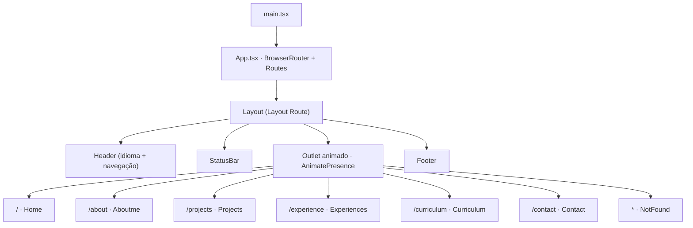
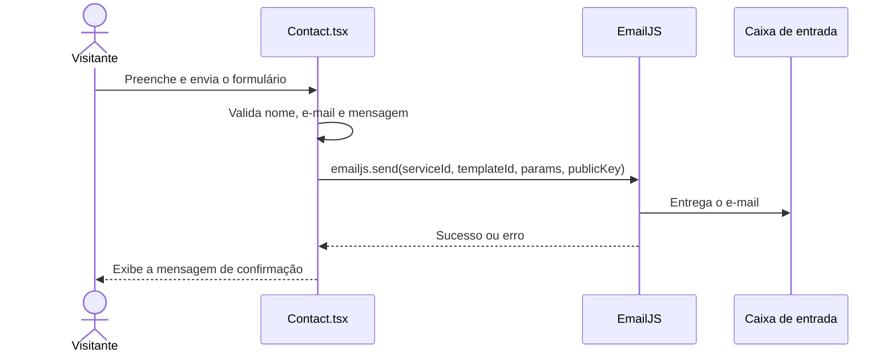

<!-- Este README foi criado a partir do template de documentação do Prof. Dr. João Paulo Aramuni e adaptado ao projeto Portfolio Profissional -->

---

# 🏷️ Vítor Souza | Portfolio Profissional 👨‍💻

> [!NOTE]
> Portfólio interativo em **React** que apresenta **quem eu sou, meus projetos, minha experiência e formas de contato** em um só lugar, com navegação por rotas, animações com **Motion** e suporte a dois idiomas (PT-BR e EN).

<table>
  <tr>
    <td width="800px">
      <div align="justify">
        Este <b>Portfolio Profissional</b> é uma <i>Single Page Application</i> desenvolvida com <b>React, TypeScript e Vite</b>, criada para apresentar o meu perfil como estudante de <b>Engenharia de Software</b> na PUC Minas. A aplicação reúne uma <i>página inicial com carrossel de cards</i>, uma página <i>Sobre mim</i> com card arrastável, uma <i>galeria de projetos em carrossel</i>, uma <i>linha do tempo de experiência</i> e um <i>formulário de contato funcional</i> integrado ao <b>EmailJS</b>. O objetivo é oferecer uma experiência <b>visual, fluida e organizada</b>, facilitando que recrutadores e interessados em <i>estágios</i> e <i>trabalhos como freelancer</i> conheçam meu trabalho e entrem em contato. Todo o conteúdo é <b>orientado a dados</b> (arquivos em <code>src/data</code>), o que torna a atualização de projetos, experiências e links simples e rápida.
      </div>
    </td>
    <td>
      <div>
        
      </div>
    </td>
  </tr> 
</table>

---

## 🚧 Status do Projeto

### Exemplos de badges básicos:


[](#-licença)

### Outros exemplos de badges:

              

---

## 📚 Índice
- [Links Úteis](#-links-úteis)
- [Sobre o Projeto](#-sobre-o-projeto)
- [Funcionalidades Principais](#-funcionalidades-principais)
- [Tecnologias Utilizadas](#-tecnologias-utilizadas)
- [Arquitetura](#-arquitetura)
  - [Exemplos de diagramas](#exemplos-de-diagramas)
- [Instalação e Execução](#-instalação-e-execução)
  - [Pré-requisitos](#pré-requisitos)
  - [Variáveis de Ambiente](#-variáveis-de-ambiente)
     - [1 Front-end (React, Vite)](#1-front-end-react-vite)
     - [2 Exemplos de Variáveis de Ambiente na Vercel e na Netlify](#2-exemplos-de-variáveis-de-ambiente-na-vercel-e-na-netlify)
  - [Instalação de Dependências](#-instalação-de-dependências)
    - [Front-end (React)](#front-end-react)
  - [Configuração do Serviço de E-mail (EmailJS)](#-configuração-do-serviço-de-e-mail-emailjs)
  - [Como Executar a Aplicação](#-como-executar-a-aplicação)
    - [Terminal: Front-end (React, Vite)](#terminal-front-end-react-vite)
    - [Build de Produção e Pré-visualização Local](#-build-de-produção-e-pré-visualização-local)
    - [Passos para build, pré-visualização e execução](#-passos-para-build-pré-visualização-e-execução)
- [Deploy](#-deploy)
- [Estrutura de Pastas](#-estrutura-de-pastas)
- [Demonstração](#-demonstração)
  - [Versão Mobile (Responsiva)](#-versão-mobile-responsiva)
  - [Aplicação Web](#-aplicação-web)
  - [Exemplo de saída no Terminal (para Build e Servidor de Desenvolvimento)](#-exemplo-de-saída-no-terminal-para-build-e-servidor-de-desenvolvimento)
- [Testes](#-testes)
- [Documentações utilizadas](#-documentações-utilizadas)
- [Autores](#-autores)
- [Contribuição](#-contribuição)
- [Agradecimentos](#-agradecimentos)
- [Licença](#-licença)

---

## 🔗 Links Úteis
* 🌐 **Demo Online:** [Acesse a Aplicação Web](<link-da-demo-web>)
  > 💻 **Descrição:** Link para o portfólio em ambiente de produção (Ex: hospedado na Vercel, Netlify ou GitHub Pages).
* 👤 **Perfis Profissionais:** [GitHub](https://github.com/Vitor-vas) | [LinkedIn](https://www.linkedin.com/in/vitorasouza/) | [E-mail](mailto:vitoraugustosouzas007@gmail.com)
  > 🔗 **Descrição:** Links diretos para o meu código, perfil profissional e contato por e-mail.
* 📖 **Documentação:** [Leia a seção de Documentações utilizadas](#-documentações-utilizadas)
  > 📚 **Descrição:** Acesso à documentação das principais tecnologias utilizadas no projeto (React, Vite, Motion, React Router e EmailJS).

---

## 📝 Sobre o Projeto
O **Portfolio Profissional** nasceu da necessidade de reunir, em um único lugar e de forma interativa, o que eu construo e quem eu sou como desenvolvedor.

- **Por que ele existe** — para ter uma vitrine própria, mais autêntica e dinâmica do que um currículo em PDF, mostrando na prática meu domínio de **React**, **TypeScript** e **animações de interface**.
- **Qual problema ele resolve** — centraliza projetos, experiência acadêmica/profissional e canais de contato, evitando que recrutadores precisem navegar por vários perfis e repositórios para me conhecer.
- **Qual o contexto** — projeto pessoal e acadêmico, desenvolvido durante a graduação em **Engenharia de Software na PUC Minas**, que serve também como laboratório para boas práticas de front-end e interação humano-computador (IHC).
- **Onde ele pode ser utilizado** — em processos seletivos de **estágio**, oportunidades de **freelancer** e como cartão de visitas digital em redes profissionais.

**O que ele entrega de valor:** uma navegação fluida entre páginas, projetos apresentados com descrição, tecnologias, repositório e imagem, e um formulário de contato que envia mensagens diretamente para o meu e-mail.

> [!NOTE]
> Todo o conteúdo é editável sem mexer na lógica das páginas: projetos em `src/data/projects.ts`, experiências em `src/data/experiences.ts`, links de contato em `src/data/socials.ts`, cards da página inicial em `src/data/cards.ts` e o texto de "Sobre mim" em `src/pages/Aboutme.tsx`.

---

## ✨ Funcionalidades Principais

- 🧭 **Navegação por Rotas:** React Router com layout compartilhado (cabeçalho, barra de status e rodapé) e **transições animadas** entre as páginas.
- 🎠 **Carrossel na Página Inicial:** cards que podem ser navegados por arrastar, clicar, botões de controle e paginação, levando às demais páginas.
- 🪪 **Sobre mim:** card único, **arrastável** pela tela, com retorno ao centro por duplo clique.
- 🗂️ **Projetos em Carrossel:** cards em leque; ao selecionar um projeto, os demais somem e o escolhido vai ao centro com descrição, tecnologias, links e imagem.
- 🕒 **Linha do Tempo de Experiência:** cargos, datas com duração calculada automaticamente, local, tópicos com **"Ver mais"** e tags de tecnologias.
- ✉️ **Formulário de Contato Funcional:** validação de campos, envio via **EmailJS**, proteção *honeypot* contra bots, atalho `⌘/Ctrl + Enter` e botões para GitHub, LinkedIn, WhatsApp e Instagram.
- 🌐 **Internacionalização (i18n):** alternância entre **PT-BR e EN** pelo cabeçalho, via Context API (aplicada nas páginas *Sobre mim* e *Experiência*).
- 📱 **Ajustes para Telas Pequenas:** layouts adaptados nas páginas *Sobre mim*, *Projetos*, *Experiência* e *Contato*.
- 🚧 **Currículo:** página reservada e já roteada, com o conteúdo em construção.

---

## 🛠 Tecnologias Utilizadas

As seguintes ferramentas, frameworks e bibliotecas foram utilizados na construção deste projeto. Recomenda-se o uso das versões listadas (ou superiores) para garantir a compatibilidade.

### 💻 Front-end

* **Framework/Biblioteca:** React v19 (com React Compiler habilitado via plugin do Babel)
* **Linguagem/Superset:** TypeScript v6
* **Roteamento:** React Router v7 (`react-router-dom`)
* **Animações:** Motion v14 (`motion/react`)
* **Estilização:** CSS puro (arquivo global `index.css` + um arquivo por página)
* **Gerenciamento de Estado:** Hooks do React (`useState`, `useRef`) e Context API (idioma)
* **Build Tool:** Vite v8

### 🔌 Serviços Externos

* **Envio de E-mail:** EmailJS (`@emailjs/browser` v4), sem necessidade de back-end próprio
* **Back-end / Banco de Dados:** não se aplica, o projeto é 100% front-end

### 🧰 Qualidade de Código

* **Lint:** oxlint
* **Verificação de Tipos:** TypeScript (`tsc -b` executado antes do build)

### ⚙️ Infraestrutura & DevOps

* **Controle de Versão:** Git e GitHub
* **Hospedagem:** qualquer provedor de sites estáticos (Ex: Vercel, Netlify, GitHub Pages)
* **Build:** `tsc -b && vite build`, gerando a pasta `dist`

---

## 🏗 Arquitetura

O projeto é uma **Single Page Application (SPA)** sem back-end. Toda a interface é construída no navegador, e o único serviço externo é o **EmailJS**, usado para entregar as mensagens do formulário de contato.

**Visão geral:**

- **Layout Route:** o componente `Layout` envolve todas as páginas e mantém `Header`, `StatusBar` e `Footer` montados; apenas o conteúdo central muda entre rotas.
- **Transições de página:** `AnimatePresence` com `useOutlet()` permite que a página atual execute a animação de saída antes da próxima entrar.
- **Interface orientada a dados:** projetos, experiências, cards e links ficam em `src/data`, separados dos componentes.
- **Idioma global:** o estado do idioma vive no `Layout` e é compartilhado por Context API (`LanguageContext` + hook `useLang`).
- **Páginas e componentes:** `src/pages` contém uma página por rota; `src/components` reúne as peças reutilizáveis (cabeçalho, carrossel, cards, rodapé).

**Padrões e decisões adotadas:**

- **Padrões de design:** Layout Route, Provider/Context, Data-driven UI e *Variants* do Motion para animações declarativas.
- **Imagens dos projetos:** resolvidas por `src/utils/projectImage.ts` com `import.meta.glob`, permitindo informar apenas o nome do arquivo em `projects.ts`.
- **Contato sem back-end:** o EmailJS dispensa um servidor próprio; as chaves ficam em variáveis `VITE_*`.

**Trade-offs e limitações:**

- Por ser uma SPA com `BrowserRouter`, o provedor de hospedagem precisa redirecionar todas as rotas para `index.html` (veja a seção [Deploy](#-deploy)).
- Sem renderização no servidor (SSR), o conteúdo é montado no navegador.
- A chave pública do EmailJS é visível no navegador por natureza; recomenda-se restringir os domínios permitidos no painel do serviço.
- A tradução PT-BR/EN ainda não cobre todas as páginas.

### Exemplos de diagramas

Para melhor visualização e entendimento da estrutura do sistema, os principais fluxos estão descritos nos diagramas abaixo.

**Visão Geral (Rotas e Layout)**



**Fluxo do Formulário de Contato**



---

## 🔧 Instalação e Execução

### Pré-requisitos
Certifique-se de que o usuário tenha o ambiente configurado.

* **Node.js:** Versão **20.19+** ou **22.12+** (requisito do Vite 8)
* **Gerenciador de Pacotes:** npm (ou yarn)
* **Conta no EmailJS** (Opcional, necessária apenas para o formulário de contato enviar e-mails)

---

### 🔑 Variáveis de Ambiente

Crie um arquivo `.env` específico e/ou configure as variáveis de ambiente no seu provedor de hospedagem.

> [!NOTE]
> O projeto é 100% front-end, portanto não há variáveis de ambiente de back-end ou de banco de dados.

#### 1 Front-end (React, Vite)

Crie um arquivo **`.env`** na raiz do projeto (você pode copiar o modelo com `cp .env.example .env`) e use o prefixo `VITE_` para expor as variáveis ao *bundle* da aplicação.

| Variável | Descrição | Exemplo |
| :--- | :--- | :--- |
| `VITE_EMAILJS_SERVICE_ID` | ID do serviço de e-mail configurado no EmailJS. | `service_xxxxxxx` |
| `VITE_EMAILJS_TEMPLATE_ID` | ID do template de e-mail do EmailJS. | `template_xxxxxxx` |
| `VITE_EMAILJS_PUBLIC_KEY` | Chave pública da conta no EmailJS. | `sua_public_key_aqui` |

---

#### 2. Exemplos de Variáveis de Ambiente na Vercel e na Netlify

Ambas as plataformas permitem configurar variáveis no painel do projeto. Os exemplos abaixo usam as mesmas variáveis do arquivo `.env`.

---

##### **Exemplo 1 – Vercel (Project Settings > Environment Variables)**

```
VITE_EMAILJS_SERVICE_ID=seu_service_id_aqui
VITE_EMAILJS_TEMPLATE_ID=seu_template_id_aqui
VITE_EMAILJS_PUBLIC_KEY=sua_public_key_aqui
```

---

##### **Exemplo 2 – Netlify (Site configuration > Environment variables)**

```
VITE_EMAILJS_SERVICE_ID=seu_service_id_aqui
VITE_EMAILJS_TEMPLATE_ID=seu_template_id_aqui
VITE_EMAILJS_PUBLIC_KEY=sua_public_key_aqui
```

> **Obs:** As variáveis de ambiente em projetos **Vite** precisam começar com `VITE_` para que o Vite as reconheça e as inclua no *bundle* do frontend; variáveis sem esse prefixo não ficam disponíveis no código do cliente. Após alterar o `.env`, reinicie o servidor de desenvolvimento.

---

Para adicionar essas variáveis em produção:

1.  Acesse a página de variáveis de ambiente do seu projeto na plataforma escolhida.
2.  Clique em **"Add"** (ou equivalente) para adicionar cada variável com o nome e valor correspondente.
3.  Faça um novo deploy para que o build use os valores atualizados.

Alternativamente, se estiver desenvolvendo localmente, crie um arquivo **`.env`** na raiz do projeto com o seguinte conteúdo:

```
# Serviço de e-mail do formulário de contato (EmailJS)
VITE_EMAILJS_SERVICE_ID=seu_service_id_aqui
VITE_EMAILJS_TEMPLATE_ID=seu_template_id_aqui
VITE_EMAILJS_PUBLIC_KEY=sua_public_key_aqui
```

> 💡 **Localização:** Garanta que este arquivo esteja na **raiz do projeto** (ao lado do `package.json`) para que o **Vite** consiga carregá-lo durante o desenvolvimento. O `.gitignore` já impede que ele seja versionado.

### 📦 Instalação de Dependências

Clone o repositório e instale as dependências.

1.  **Clone o Repositório:**

```bash
git clone <URL_DO_SEU_REPOSITÓRIO>
cd Vitor-vas-portfolio
```

2.  **Instale as Dependências:**

Como o projeto possui uma única aplicação, basta instalar as dependências do Node.js na raiz do repositório.

#### Front-end (React)

```bash
npm install
# ou
yarn install
```

---

### 💾 Configuração do Serviço de E-mail (EmailJS)

O formulário de contato envia as mensagens pelo **EmailJS**. Sem essa configuração o site funciona normalmente, mas o envio de mensagens retorna erro.

1. **Crie uma conta e um serviço de e-mail:**  
   Acesse o [painel do EmailJS](https://dashboard.emailjs.com), conecte o seu provedor de e-mail em **Email Services** e copie o **Service ID**.

2. **Crie um template:**  
   Em **Email Templates**, crie um template usando as variáveis enviadas pelo formulário e copie o **Template ID**.

```
{{name}}      -> nome de quem enviou
{{email}}     -> e-mail de quem enviou (use também no campo "Reply To")
{{subject}}   -> assunto (padrão: "Portfolio contact")
{{message}}   -> mensagem
```

3. **Copie a chave pública:**  
   Em **Account**, copie a **Public Key**.

4. **Preencha o arquivo `.env`:**

```bash
cp .env.example .env
# edite o .env com o Service ID, o Template ID e a Public Key
```

> 💡 **Dica:** Em **Security**, no painel do EmailJS, restrinja os domínios permitidos para evitar o uso indevido da sua chave pública.

---

### ⚡ Como Executar a Aplicação
Execute a aplicação em modo de desenvolvimento em **um único terminal**.

#### Terminal: Front-end (React, Vite)

Inicie o servidor de desenvolvimento do Front-end.

```bash
npm run dev
# ou
yarn dev
```
🎨 *O Front-end estará disponível em **http://localhost:5173** (ou a porta configurada no Vite).*

---

#### 🏗️ Build de Produção e Pré-visualização Local

Para testar localmente exatamente o que será publicado, gere o build de produção e sirva a pasta `dist` com o servidor de pré-visualização do Vite.

Antes de tudo, certifique-se de que as dependências estão instaladas (`npm install`) e de que o arquivo `.env` está configurado.

---

#### 📦 Passos para build, pré-visualização e execução

1. Acesse a pasta raiz do projeto (onde o arquivo `package.json` está localizado):

```bash
cd /caminho/do/projeto/Vitor-vas-portfolio
```

2. Verifique o código com o lint:

```bash
npm run lint
```

3. Gere o build de produção (executa a verificação de tipos e o build do Vite):

```bash
npm run build
```

> [!NOTE]
> 💡 O comando `npm run build` executa `tsc -b && vite build`. Se houver qualquer erro de tipagem, o build é interrompido antes de gerar a pasta `dist`.

4. Sirva o build localmente:

```bash
npm run preview
```

5. Abra no navegador:
   A pré-visualização estará acessível na porta exibida no terminal (Exemplo: <http://localhost:4173>)

6. Para encerrar o servidor, pressione `Ctrl + C` no terminal.

✅ **Em resumo:** Usar **`npm run dev`** durante o desenvolvimento e **`npm run build` + `npm run preview`** antes de publicar garante que o site se comporta em produção da mesma forma que no ambiente local.

---

## 🚀 Deploy
Instruções claras para deploy em produção.

1.  **Build do Projeto:**
    Execute o build para gerar os arquivos estáticos do Front-end.

```bash
# Build do Front-end (React/Vite) - Gera a pasta /dist com arquivos estáticos
npm run build
```

2.  **Configuração do Ambiente de Produção:** Defina as variáveis de ambiente no seu provedor (e.g., Vercel, Netlify, GitHub Pages).

> 🔑 **Variáveis Cruciais:** Certifique-se de configurar `VITE_EMAILJS_SERVICE_ID`, `VITE_EMAILJS_TEMPLATE_ID` e `VITE_EMAILJS_PUBLIC_KEY` no provedor, caso contrário o formulário de contato não enviará mensagens.

3.  **Redirecionamento das Rotas (SPA):**
    Como o projeto usa `BrowserRouter`, abrir diretamente uma URL como `/projects` exige que o servidor devolva o `index.html` para todas as rotas.

```json
// Vercel: crie o arquivo vercel.json na raiz do projeto
{
  "rewrites": [{ "source": "/(.*)", "destination": "/index.html" }]
}
```

```
# Netlify: crie o arquivo public/_redirects
/* /index.html 200
```

4.  **Execução em Produção:**
    A forma de execução depende do seu provedor, mas como o projeto gera apenas arquivos estáticos, ele não é executado via Node, e sim servido por um servidor web.

```bash
# 🟢 Execução do Front-end (React/Vite)
# Exemplo de servidor de arquivos estáticos (usando Nginx, Vercel, Netlify, etc.)
# Para simular a produção localmente ou rodar em uma VPS simples, use o pacote 'serve':
npm install -g serve
serve -s dist
```

---

## 📂 Estrutura de Pastas

Descreva o propósito das pastas principais.

```
.
├── .env                         # 🔒 Variáveis SENSÍVEIS do ambiente LOCAL (não versionado).
├── .env.example                 # 🧩 Exemplo das variáveis necessárias (sem valores sensíveis).
├── .gitignore                   # 🧹 Ignora arquivos/pastas não versionadas (.env, node_modules, dist, etc.).
├── .oxlintrc.json               # ✨ Regras do oxlint.
├── README.md                    # 📘 Documentação principal do projeto.
├── index.html                   # 📄 Documento HTML de entrada da aplicação.
├── package.json                 # 📦 Dependências e scripts.
├── package-lock.json            # 🔒 Lockfile das dependências.
├── tsconfig.json                # 🛠️ Configuração base do TypeScript.
├── tsconfig.app.json            # 🛠️ Configuração do TypeScript para o código da aplicação.
├── tsconfig.node.json           # 🛠️ Configuração do TypeScript para arquivos do Vite.
├── vite.config.ts               # ⚡ Configuração do Vite (React + React Compiler).
│
├── /public                      # 📂 Arquivos estáticos servidos na raiz (favicon, ícones).
│
└── /src                         # 📂 Código-fonte React
    ├── main.tsx                 # 🚪 Ponto de entrada da aplicação.
    ├── App.tsx                  # 🧭 Definição das rotas (React Router).
    │
    ├── /components              # 🧱 Componentes reutilizáveis (UI).
    │   ├── Layout.tsx           # 🧩 Layout compartilhado, transições de página e provedor de idioma.
    │   ├── Header.tsx           # 🔝 Logo, navegação e troca de idioma.
    │   ├── Statusbar.tsx        # 📶 Barra de status.
    │   ├── Footer.tsx           # 🔚 Rodapé com competências e links.
    │   ├── Card.tsx             # 🃏 Card do carrossel da página inicial.
    │   ├── Cardcarousel.tsx     # 🎠 Carrossel de cards.
    │   └── Carouselcontrols.tsx # 🎛️ Botões e paginação do carrossel.
    │
    ├── /pages                   # 📄 Páginas/rotas da aplicação.
    │   ├── Home.tsx             # 🏠 Página inicial (carrossel).
    │   ├── Aboutme.tsx          # 🪪 Sobre mim (card arrastável).
    │   ├── Projects.tsx         # 🗂️ Projetos (carrossel em leque).
    │   ├── Experiences.tsx      # 🕒 Experiência (linha do tempo).
    │   ├── Curriculum.tsx       # 📑 Currículo (em construção).
    │   ├── Contact.tsx          # ✉️ Contato (formulário e links sociais).
    │   └── NotFound.tsx         # 🚫 Página 404.
    │
    ├── /context                 # 🌐 Contextos globais.
    │   └── LanguageContext.ts   # 🗣️ Idioma (PT-BR/EN) e hook useLang.
    │
    ├── /data                    # 🗃️ Conteúdo editável do portfólio.
    │   ├── cards.ts             # 🃏 Cards da página inicial e links do rodapé.
    │   ├── projects.ts          # 🗂️ Lista de projetos.
    │   ├── experiences.ts       # 🕒 Lista de experiências.
    │   └── socials.ts           # 🔗 Links dos botões da página de contato.
    │
    ├── /styles                  # 🎨 Estilos globais e por página.
    │   ├── index.css            # 🎨 Estilos globais e variáveis de cor.
    │   ├── App.css              # 🎨 Estilos adicionais da aplicação.
    │   ├── aboutme.css          # 🎨 Estilos da página Sobre mim.
    │   ├── projects.css         # 🎨 Estilos da página Projetos.
    │   ├── experience.css       # 🎨 Estilos da página Experiência.
    │   └── contact.css          # 🎨 Estilos da página Contato.
    │
    ├── /assets                  # 🖼️ Recursos estáticos importados
    │   └── /projects            # 🖼️ Imagens dos projetos (crie a pasta e adicione os arquivos).
    │
    ├── /types                   # 🧬 Tipos TypeScript compartilhados.
    │   └── Index.ts
    │
    └── /utils                   # 🛠️ Funções utilitárias.
        └── projectImage.ts      # 🖼️ Resolve o caminho das imagens dos projetos.
```

---

## 🎥 Demonstração

Use GIFs e prints para mostrar o projeto em ação.  

> [!WARNING]
> Dê preferência a hospedar suas imagens em um **CDN** (Content Delivery Network) ou no **GitHub Pages** para garantir que elas carreguem rapidamente e não quebrem. Saiba mais sobre o GitHub Pages clicando [aqui](https://github.com/joaopauloaramuni/joaopauloaramuni.github.io).

### 📱 Versão Mobile (Responsiva)

- GIF de demonstração (exemplo de navegação no celular):  

| Demonstração 1 | Demonstração 2 | Demonstração 3 | Demonstração 4 |
|----------------|----------------|----------------|----------------|
| _Sua gif aqui_ | _Sua gif aqui_ | _Sua gif aqui_ | _Sua gif aqui_ |

Para melhor visualização, as telas principais estão organizadas lado a lado.

| Tela | Captura de Tela |
| :---: | :---: |
| **Página Inicial (Home)** | **Sobre mim** |
| _Sua captura aqui_ | _Sua captura aqui_ |
| **Projetos** | **Contato** |
| _Sua captura aqui_ | _Sua captura aqui_ |

### 🌐 Aplicação Web

Para melhor visualização, as telas principais estão organizadas lado a lado.

| Tela | Captura de Tela |
| :---: | :---: |
| **Página Inicial (Home)** | **Sobre mim** |
| _Sua captura aqui_ | _Sua captura aqui_ |
| **Projetos** | **Projeto Selecionado** |
| _Sua captura aqui_ | _Sua captura aqui_ |
| **Experiência** | **Contato** |
| _Sua captura aqui_ | _Sua captura aqui_ |

### 💻 Exemplo de Saída no Terminal (para Build e Servidor de Desenvolvimento)

Como o projeto não possui back-end, esta seção demonstra a saída esperada dos principais comandos do dia a dia.

#### 1. Demonstração do Servidor de Desenvolvimento

Inicia o Vite em modo de desenvolvimento, com recarregamento automático.

```bash
npm run dev
```

**Saída Esperada:**
```text
  VITE v8.3.4  ready in 350 ms

  ➜  Local:   http://localhost:5173/
  ➜  Network: use --host to expose
```

---

#### 2. Demonstração do Build de Produção

Verifica os tipos com o TypeScript e gera os arquivos estáticos na pasta `dist`.

```bash
npm run build
```

**Saída Esperada:**
```text
> portfolio@0.0.0 build
> tsc -b && vite build

vite v8.3.4 building for production...
✓ módulos transformados.
dist/index.html
dist/assets/...
✓ built in ...
```

---

## 🧪 Testes

### Testes Unitários e de Integração
Ainda não há testes automatizados neste projeto.

*Ferramenta sugerida: Vitest com React Testing Library.*

### Testes End-to-End (E2E)
Ainda não há testes de ponta a ponta neste projeto.

*Ferramenta sugerida: Playwright.*

### Verificações Disponíveis
Enquanto os testes automatizados não são implementados, utilize as verificações abaixo antes de cada commit:

```
npm run lint
npm run build
```
*Ferramentas utilizadas: oxlint (análise estática) e TypeScript (verificação de tipos).*

---

## 🔗 Documentações utilizadas

Liste aqui links para documentação técnica, referências de bibliotecas complexas ou guias de estilo que foram cruciais para o projeto.

* 📖 **Framework/Biblioteca (Front-end):** [Documentação Oficial do **React**](https://react.dev/reference/react)
* 📖 **Build Tool (Front-end):** [Guia de Configuração do **Vite**](https://vite.dev/config/)
* 📖 **Linguagem:** [Documentação do **TypeScript**](https://www.typescriptlang.org/docs/)
* 📖 **Roteamento:** [Documentação do **React Router**](https://reactrouter.com/)
* 📖 **Animações:** [Documentação do **Motion para React**](https://motion.dev/docs/react)
* 📖 **Envio de E-mail:** [Documentação do **EmailJS**](https://www.emailjs.com/docs/)
* 📖 **Lint:** [Documentação do **oxlint**](https://oxc.rs/docs/guide/usage/linter.html)
* 📖 **Guia de Estilo:** [**Conventional Commits** (Padrão de Mensagens)](https://www.conventionalcommits.org/en/v1.0.0/)

---

## 👥 Autores
Liste os principais contribuidores. Você pode usar links para seus perfis.

| 👤 Nome | 🖼️ Foto | :octocat: GitHub | 💼 LinkedIn | 📤 Gmail |
|---------|----------|-----------------|-------------|-----------|
| Vítor Augusto de Souza | <div align="center"></div> | <div align="center"><a href="https://github.com/Vitor-vas"></a></div> | <div align="center"><a href="https://www.linkedin.com/in/vitorasouza/"></a></div> | <div align="center"><a href="mailto:vitoraugustosouzas007@gmail.com"></a></div> |

> [!TIP]
> 💡 **Dica:** Escolha uma foto profissional, preferencialmente de rosto, evitando imagens com baixa qualidade, filtros excessivos ou elementos distrativos.

---

## 🤝 Contribuição
Este é um projeto pessoal, mas sugestões e correções são bem-vindas. Para contribuir:

1.  Faça um `fork` do projeto.
2.  Crie uma branch para sua feature (`git checkout -b feature/minha-feature`).
3. Commit suas mudanças (`git commit -m 'feat: adiciona nova funcionalidade X'`). **(Utilize [Conventional Commits](https://www.conventionalcommits.org/en/v1.0.0/))**
4.  Faça o `push` para a branch (`git push origin feature/minha-feature`).
5.  Abra um **Pull Request (PR)**.

> [!IMPORTANT]
> 📝 **Regras:** Antes de abrir um Pull Request, execute `npm run lint` e `npm run build` para garantir que o código passa na análise estática e na verificação de tipos.

---

## 🙏 Agradecimentos
Em ambiente acadêmico, citar fontes e inspirações é crucial (integridade acadêmica). Em ambiente profissional, mostra humildade e conexão com a comunidade.

Gostaria de agradecer às seguintes pessoas e instituições que foram fundamentais para o desenvolvimento deste projeto:

* [**Engenharia de Software PUC Minas**](https://www.instagram.com/engsoftwarepucminas/) - Pelo apoio institucional, estrutura acadêmica e fomento à inovação e boas práticas de engenharia.
* [**Prof. Dr. João Paulo Aramuni**](https://github.com/joaopauloaramuni) - Pelo template de documentação que serviu de base para este README.

---

## 📄 Licença

Este projeto é distribuído sob a **[Licença MIT](./LICENSE)**.

---